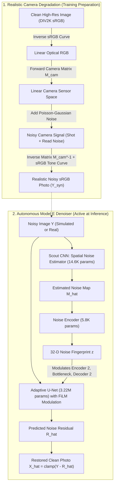
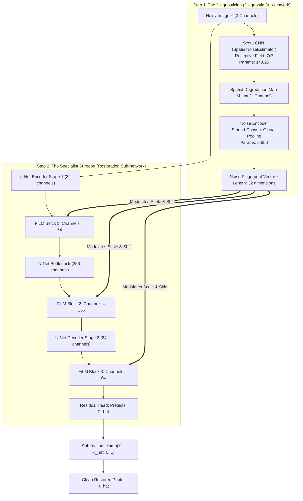
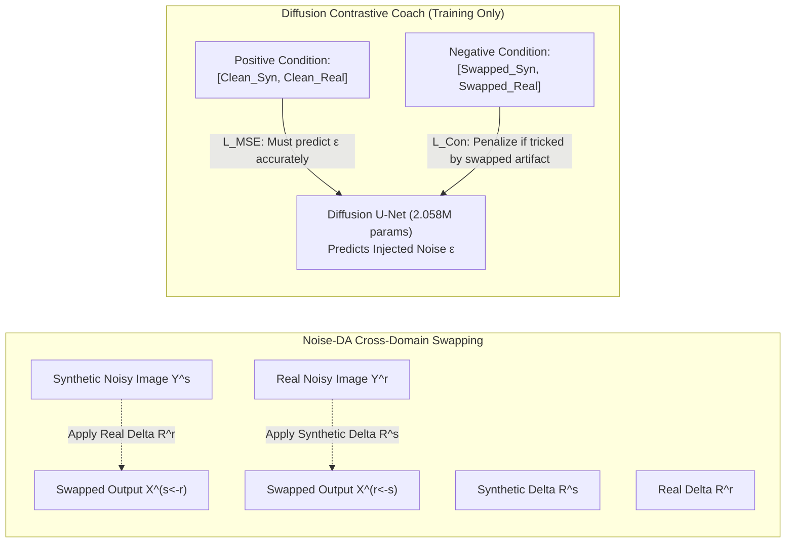
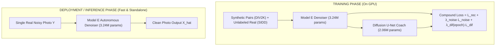

# Complete System Architecture & Pipeline Guide
**Project:** Adaptive Noise-Aware U-Net with Heteroscedastic Noise Modeling and Diffusion-Based Domain Adaptation  
**Target:** Master's Thesis Defense & Scientific Documentation  
**Language:** Simple, Intuitive, and Rigorous  

---

## 🌟 Executive Summary: The Big Picture in Plain English

Imagine taking a photo in a dimly lit restaurant on your smartphone:
1. **The Physical Reality:** Photons hit the camera sensor unevenly. The camera sensor produces random physical noise—more noise in bright areas (Poisson shot noise) and baseline circuit noise in dark areas (Gaussian read noise).
2. **The Camera's Internal Brain (ISP):** The camera doesn't show you the raw sensor data. It applies digital color matrices and non-linear gamma curves (the Image Signal Processor, or ISP) to turn raw signals into an sRGB photo. This twists and warps the noise into complex, color-correlated grain.
3. **The Classical Problem:** Standard AI denoisers are trained on uniform fake static (Additive White Gaussian Noise, or AWGN). When fed real camera photos, they fail—either smearing fine textures or leaving behind colored blotches.
4. **Our Solution:**
   - **Sensor-Accurate Noise Synthesis:** We simulate real camera physics and an invertible ISP pipeline.
   - **Autonomous Adaptive Denoiser (Model E):** A model that first *scouts* how noisy each region is, encodes that into a 32-number "noise fingerprint", and dynamically tunes its own internal filters via FiLM modulation.
   - **Training-Only Diffusion Regularizer (Noise-DA):** A diffusion model that acts as a strict "coach" during training to bridge the gap between synthetic and real-world smartphone photos. At inference time, this coach is **completely stripped away**, eliminating all iterative diffusion sampling latency, while the feedforward Scout CNN and FiLM layers run in a single pass with negligible compute overhead.

---

## 🗺️ High-Level System Flowchart

The entire lifecycle consists of two halves: **Physical Degradation Simulation** (creating realistic training pairs) and **Autonomous Restoration** (cleaning the photo).

---

## 🔬 Component 1: Sensor Physics & The Invertible ISP

### Why Can't We Just Add Random Gaussian Noise?
Real digital sensors follow quantum mechanics:
- **Photon Shot Noise ($I_{\text{shot}}$):** Light arrives as discrete packets (photons). According to the Poisson distribution, the variance of arrival is proportional to the light intensity itself: $\text{Var} \propto I$.
- **Circuit Read Noise ($\epsilon_{\text{read}}$):** Thermal agitation inside the sensor readout circuitry adds zero-mean Gaussian electronic noise: $\epsilon \sim \mathcal{N}(0, b)$.
- **Heteroscedastic Property:** Combining both creates a linear variance curve:
  $$\operatorname{Var}(Y \mid I) = a \cdot I + b$$
  *(Bright pixels have high variance; dark pixels have low variance. That is why noise is heteroscedastic, not uniform!)*

### The Invertible Camera ISP
Before noise hits the screen, the camera converts it. We mathematically model this forward and backward:

```mermaid
flowchart LR
    A["sRGB [0, 1]"] -->|"1. Linearize (Gamma 2.4)"| B["Linear RGB"]
    B -->|"2. Forward Matrix M_cam"| C["Camera Space RGB"]
    C -->|"3. Physical Noise: a·I + b"| D["Noisy Camera RGB"]
    D -->|"4. Inverse Matrix M_cam^-1"| E["Noisy Linear RGB"]
    E -->|"5. sRGB Tone Map"| F["Noisy sRGB [0, 1]"]
```

> **Round-Trip Fidelity Guarantee:** If zero noise is added, this pipeline inverts itself perfectly back to the original image with **$>150.00\text{ dB PSNR}$** (exact mathematical reversibility).

---

## 🧠 Component 2: Model E (The Autonomous Adaptive Denoiser)

Model E operates like a medical clinic with two roles: **The Diagnostician** and **The Specialist Surgeon**.

### How Does FiLM Modulation Work?
FiLM stands for **Feature-wise Linear Modulation**. Think of it as a set of dynamic volume knobs on the neural network's features:
$$F' = (1 + \gamma(z)) \odot F + \beta(z)$$
- $F$ is the feature map inside the U-Net.
- $\gamma(z)$ scales the feature up or down (how aggressively to smooth).
- $\beta(z)$ shifts the feature bias (how to adjust dark/bright color balance).
- **Zero-Initialization Guarantee:** At epoch 0, the weights producing $\gamma$ and $\beta$ are initialized to **zero**. That means $\gamma=0, \beta=0$, so $F' = 1 \cdot F + 0 = F$. The network starts exactly like a standard U-Net and safely learns how much adjustment is needed!

---

## ⚖️ Scientific Parity: Model D vs. Model E Capacity Match

In scientific research, if Model E outperforms Model D, a reviewer could ask:  
*"Did Model E win simply because it has more parameters?"*

To prevent this critique, we enforce a strict **near-capacity-matched comparison**:

| Component | Model D (Fixed Baseline) | Model E (Adaptive Ours) | Role / Location |
|---|:---:|:---:|---|
| **Base U-Net** | 3,195,331 params | 3,195,331 params | Core restoration backbone |
| **FiLM Linear Projections** | None | 25,344 params | Integrated directly inside U-Net layers |
| **Adaptive U-Net Total** | 3,195,331 params | **3,220,675 params** | U-Net + FiLM combined |
| **Scout CNN** | None | **14,625 params** | Auxiliary spatial noise estimator |
| **Noise Encoder** | None | **5,856 params** | Auxiliary latent vector projector |
| **TOTAL INFERENCE PARAMETERS** | **3,195,331** | **3,241,156** | Total parameters active at runtime |
| **Parameter Delta** | — | **+45,825 (+1.43%)** | **Scientifically Near-Capacity Matched** |

> **Key Defense Point:** A parameter increase of just **1.43%** is statistically negligible in deep learning. Any performance gain achieved by Model E is driven by **architectural intelligence (adaptive conditioning)**, not brute-force parameter scaling!

---

## 🔄 Component 3: Noise-DA (Training-Only Diffusion Regularizer)

### The Problem: Synthetic vs. Real Smartphone Gap
We train on synthetic images because we have infinite ground-truth clean pairs ($X^s$). But we want our model to excel on real smartphone images ($Y^r$), where clean ground truth does not exist.

### The Solution: Counterfactual Residual Swapping
During training, we extract the restoration deltas:
- **Synthetic Delta:** $R^s = \hat{X}^s - Y^s$
- **Real Delta:** $R^r = \hat{X}^r - Y^r$

We then "swap" the corrections across domains:
1. $\hat{X}^{s \leftarrow r} = \text{clamp}(Y^s + R^r, 0, 1)$ *(Synthetic photo cleaned using real camera noise logic)*
2. $\hat{X}^{r \leftarrow s} = \text{clamp}(Y^r + R^s, 0, 1)$ *(Real photo cleaned using synthetic noise logic)*

### The Magic of Noise-DA: Zero Inference Overhead
- **During Training:** The Diffusion Network (2,058,179 parameters) penalizes the restoration U-Net whenever its features diverge between synthetic and real photos.
- **During Testing/Deployment:** The entire Diffusion Network is **discarded**.
- **Result:** You get the domain adaptation power of diffusion, but the execution speed of a lightweight feedforward U-Net!

---

## ⏱️ Training vs. Inference: Side-by-Side Comparison

---

## 📊 The 5 Research Models: What Does Each One Prove?

Our experimental design systematically isolates each variable:

| Model | Noise Model Used | Domain Adaptation | Denoiser Type | Base Channels | Inference Params | Scientific Question Answered |
|:---:|:---:|:---:|:---:|:---:|:---:|---|
| **A** | Additive Gaussian (AWGN) | None | Standard U-Net | 64 | 12.77M | Classic baseline: How well does naive Gaussian noise do? |
| **B** | Additive Gaussian (AWGN) | **Noise-DA** | Standard U-Net | 64 | 12.77M | Does diffusion domain adaptation help even with naive noise? |
| **C** | **Heteroscedastic ISP** | None | Standard U-Net | 64 | 12.77M | How much does realistic sensor noise physics help alone? |
| **D** | **Heteroscedastic ISP** | **Noise-DA** | Standard U-Net | 32 | 3.20M | **Near-capacity baseline** for our adaptive model. |
| **E** | **Heteroscedastic ISP** | **Noise-DA** | **Adaptive FiLM** | 32 | 3.24M | **Our Full Proposed Model:** Does dynamic self-conditioning win? |

---

## 🎯 Master's Thesis Defense: Viva Cheat Sheet

If an examiner asks:

### Q1: "Why predict the noise residual $R$ instead of predicting the clean image directly?"
> **Answer:** "A clean image contains vast low-frequency spatial structure. Predicting the high-frequency residual noise ($R \approx Y - X$) simplifies the optimization landscape. Residual learning allows the identity skip connections to pass the underlying scene geometry through, letting the network focus strictly on high-frequency noise variance."

### Q2: "Why doesn't Model E run diffusion at test time?"
> **Answer:** "Iterative diffusion sampling requires 50 to 1,000 sequential passes, which is impractical for real-time mobile photography. In our framework, diffusion functions strictly as a feature-alignment regularizer during training. It guides the U-Net's feature representations to be domain-invariant, and is completely stripped away for single-pass inference."

### Q3: "Could Model E's performance just be due to its extra parameters?"
> **Answer:** "No. Model E has 3,241,156 parameters while Model D has 3,195,331 parameters—a negligible difference of just +1.43% (+45,825 parameters). Furthermore, Models A, B, and C have 12.77M parameters (nearly 4x larger). If raw capacity dictated performance, Models A-C would dominate. Model E's advantages stem entirely from its adaptive noise-awareness."

### Q4: "Why use an invertible ISP rather than training directly in camera RAW?"
> **Answer:** "End users view photos in sRGB display space, where camera manufacturers apply proprietary tone curves and color matrices that warp noise statistics. By modeling the forward and backward ISP, we train the network to handle realistic non-linear noise in display space while preserving the underlying physical sensor statistics."

